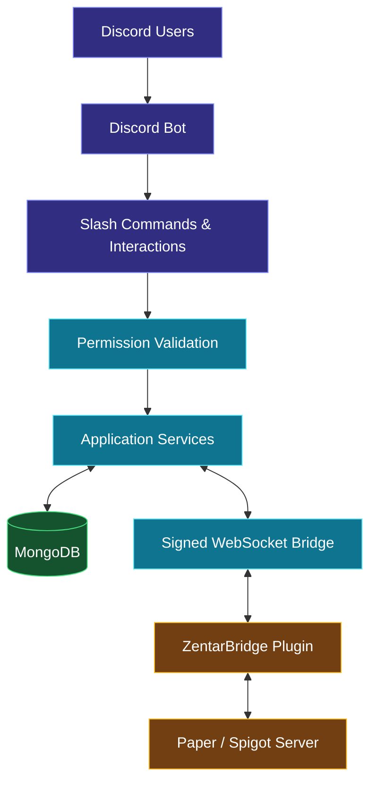

 <div align="center">


<br/>


</div>

---

## `01` — Project Overview

# ZentarNetwork Discord Bot

**A comprehensive Discord management and Minecraft integration system built for modern Minecraft server networks.**

ZentarNetwork Discord Bot, Discord sunucu yönetimini Minecraft sunucusuyla birleştiren kapsamlı bir otomasyon projesidir. Moderasyon, güvenlik, oyuncu doğrulama, destek biletleri, çekilişler, topluluk araçları ve gerçek zamanlı sunucu entegrasyonunu tek bir Discord botunda bir araya getirir.

Proje, Node.js tabanlı bot altyapısı ve Paper/Spigot için geliştirilen Minecraft köprü eklentisiyle çalışır.

> **No web dashboard. No unnecessary interfaces. Everything is managed directly through Discord.**

<div align="center">


</div>

---

## `02` — Core Features

<table>
<tr>
<td width="50%" valign="top">

### Discord Management

- Slash command architecture
- Interactive administration panels
- Embed-based management interfaces
- Buttons, select menus and modals
- Role and permission management
- Configurable logging channels
- Automated announcements
- Welcome and leave messages

</td>
<td width="50%" valign="top">

### Moderation & Protection

- Warning management
- Timeout and timeout removal
- Kick and ban commands
- Message deletion
- Slow mode controls
- Channel lock management
- Nickname management
- Moderation logs

</td>
</tr>
<tr>
<td width="50%" valign="top">

### Community Systems

- Persistent giveaway management
- Support ticket system
- Ticket claiming and closing
- Account verification
- Automatic role assignment
- Interactive role menus
- XP and leveling system
- Daily rewards and leaderboards

</td>
<td width="50%" valign="top">

### Minecraft Integration

- Real-time chat synchronization
- Player join and leave notifications
- Player information and statistics
- Server status and ping
- In-game account verification
- Maintenance mode management
- Discord-to-Minecraft announcements
- Automatic bridge reconnection

</td>
</tr>
</table>

---

## `03` — Architecture

<div align="center">



</div>

### Design principles

- **Discord-first management:** All administration is performed through Discord interactions.
- **Persistent storage:** Configuration, verification, giveaways and other supported records are stored in MongoDB.
- **Separated components:** The Discord bot and Minecraft plugin communicate through a dedicated bridge.
- **Permission-aware operations:** Authorization is checked for commands and interactive components.
- **Failure handling:** Connection recovery and explicit error responses help prevent misleading success messages.

---

## `04` — Security Architecture

The Minecraft bridge uses signed messages to help protect communication between the Discord bot and the server plugin.

| Security layer | Implementation |
|---|---|
| Message integrity | HMAC-SHA256 signatures |
| Replay protection | Unique message IDs and timestamp validation |
| Authentication | Signed handshake |
| Timing validation | Configurable timestamp window |
| Traffic control | Per-connection rate limiting |
| Payload control | Message size limits |
| Secret management | Environment variables and plugin configuration |
| Command isolation | Discord chat messages are never executed as Minecraft commands |
| Network exposure | Localhost binding by default |

### Message verification flow

```text
Incoming WebSocket Message
          |
          v
    Validate Envelope
          |
          v
     Verify HMAC
          |
          v
 Check Timestamp & Message ID
          |
          v
 Validate Message Direction
          |
          v
    Process Approved Event
```

**Security note:** HMAC authenticates message integrity but does not encrypt traffic. For communication between different machines, use `wss://` with TLS or a properly secured private network.

---

## `05` — Technology Stack

<div align="center">

### Backend & Runtime


### Database & Communication


### Tools & Infrastructure


</div>

| Technology | Purpose |
|---|---|
| Node.js 20+ | Bot runtime |
| discord.js | Discord API and interaction handling |
| MongoDB | Persistent application data |
| WebSocket | Bot–Minecraft communication |
| HMAC-SHA256 | Message authentication |
| Java 17+ | Minecraft plugin development |
| Paper / Spigot | Minecraft server compatibility |
| Maven | Plugin build management |
| Automated tests | Core logic and bridge verification |

---

## `06` — Minecraft Bridge Plugin

The `ZentarBridge` plugin connects the Minecraft server to the Discord bot.

### Supported functionality

- Minecraft chat forwarded to Discord.
- Discord messages displayed in Minecraft chat.
- Player join, leave and death notifications.
- In-game account verification.
- Server status and player information.
- Maintenance mode synchronization.
- Announcements and staff messages.
- Automatic reconnection after connection failures.

### Build

```bash
cd minecraft-plugin
mvn clean package
```

Expected output:

```text
minecraft-plugin/target/ZentarBridge-1.0.0.jar
```

### Installation

1. Build the plugin using Maven and a compatible JDK.
2. Copy the generated JAR into the Minecraft server's `plugins/` directory.
3. Start the server to generate the configuration.
4. Configure the bridge URL and shared secret.
5. Restart or reload the plugin as appropriate.
6. Use `/zentarbridge status` to inspect the connection.

The bot and plugin must use the same bridge secret.

---

## `07` — Installation & Setup

### Requirements

- Node.js 20 or newer
- MongoDB 6+ or MongoDB Atlas
- A Discord application and bot token
- Paper/Spigot server for Minecraft integration
- Java 17+ and Maven 3.8+ to build the plugin

### Windows installation

**1. Configure the environment**

Copy `.env.example` to `.env` and fill in the required settings.

```env
DISCORD_TOKEN=your_discord_bot_token
CLIENT_ID=your_discord_application_id
GUILD_ID=your_discord_server_id
MONGODB_URI=mongodb://127.0.0.1:27017/zentarnetwork
MC_BRIDGE_SECRET=your_generated_bridge_secret
```

Generate a secure bridge secret using the project's helper script:

```bash
node scripts/generate-secret.js
```

Never publish real credentials or commit the `.env` file.

**2. Install dependencies**

```bash
npm install
```

**3. Validate the configuration**

```bash
npm run check
```

**4. Register slash commands**

```bash
npm run deploy
```

**5. Start the bot**

```bash
npm start
```

If the repository includes Windows launch scripts, `install.bat` and `start.bat` can be used instead, according to their implementation.

---

## `08` — Command Reference

Commands are designed to be accessed directly from Discord.

| Category | Commands |
|---|---|
| Administration | `/admin-panel` |
| Server | `/sunucu`, `/durum`, `/ping` |
| Players | `/oyuncular`, `/oyuncu`, `/istatistik` |
| Server controls | `/sunucuyenile`, `/bakim`, `/duyuru`, `/sunucumesaj` |
| Moderation | `/uyar`, `/uyarılar`, `/timeout`, `/at`, `/yasakla` |
| Channel management | `/mesaj-sil`, `/yavaş-mod`, `/kilitle`, `/kilit-aç` |
| Support | `/destek-panel`, `/bilet` |
| Verification | `/doğrula`, `/doğrulama-kaldır` |
| Community | `/profil`, `/liderlik`, `/günlük`, `/anket` |
| Roles | `/rolmenü`, `/kurallar` |
| Events | `/etkinlik`, `/çekiliş` |
| Automated announcements | `/otoduyuru` |

*Subcommands and available options depend on the implementation in the repository.*

---

## `09` — Database & Reliability

MongoDB is used to persist supported bot data across restarts.

- Guild configuration and administration settings.
- Verification and account-linking records.
- Giveaway data and participation records.
- XP and cooldown information.
- Ticket records and related configuration.
- Maintenance state and bridge-related settings.

The application is designed to handle database reconnections, recover supported persistent state and shut down services in an orderly manner.

---

## `10` — Testing & Verification

Run the project's automated tests with:

```bash
npm test
```

The documented test suite covers core application logic, including bridge authentication, replay protection, reconnection, request/response handling and selected database-backed workflows.

**Important:** Automated tests do not by themselves prove that the bot works correctly in every real Discord server or Minecraft environment. Verify Discord permissions, slash-command registration, plugin compatibility and live bridge connectivity before production use.

---

## `11` — Project Structure

```text
ZentarNetwork/
├── src/
│   ├── commands/
│   ├── events/
│   ├── interactions/
│   ├── services/
│   ├── database/
│   └── bridge/
├── scripts/
│   ├── deploy-commands.js
│   └── generate-secret.js
├── minecraft-plugin/
│   ├── src/
│   └── pom.xml
├── tests/
├── .env.example
├── .gitignore
├── install.bat
├── start.bat
├── package.json
└── README.md
```

*Illustrative structure; actual directories may differ depending on the repository.*

---

## `12` — Development Principles

```text
01. Security before convenience.
02. Reliability over shortcuts.
03. Persistent data over temporary state.
04. Automation for repetitive tasks.
05. Clear permissions and predictable behavior.
06. Maintainable code over unnecessary complexity.
07. Honest status reporting over false success messages.
```

ZentarNetwork is built around the idea that a Minecraft network should be manageable through a reliable Discord interface without requiring a separate web dashboard.

<div align="center">

---


### S1MORG

`BUILD · AUTOMATE · PROTECT`

<sub>Designed with purpose. Developed with precision.</sub>

</div>
